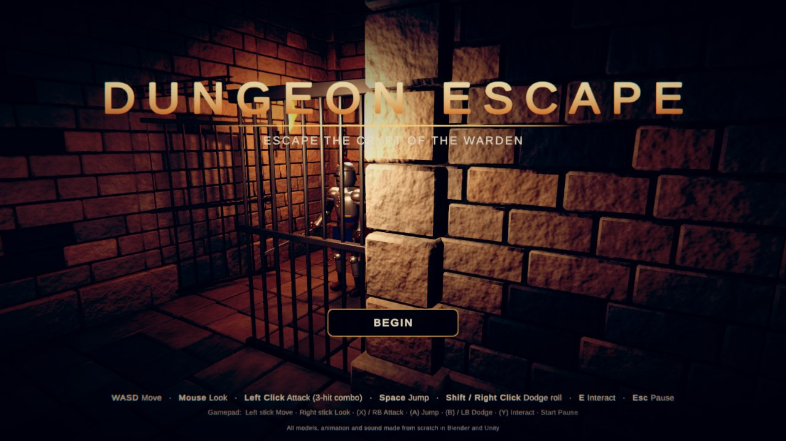
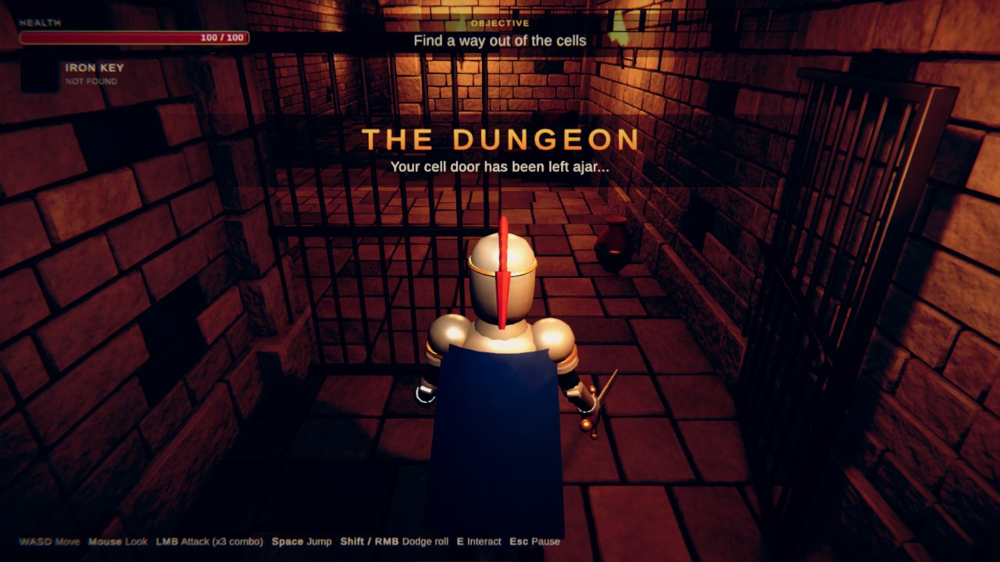
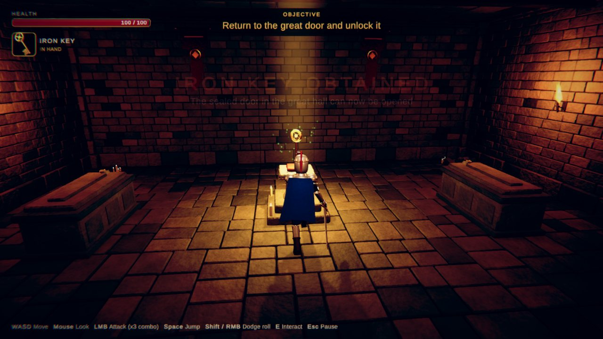
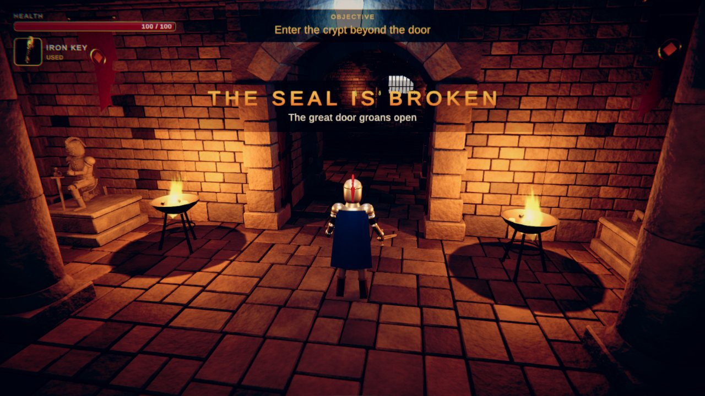
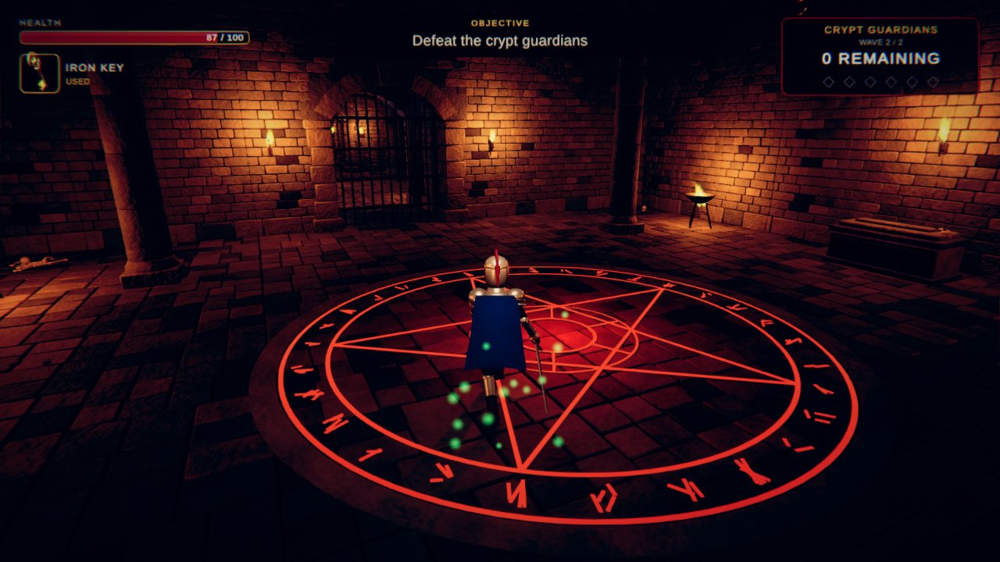
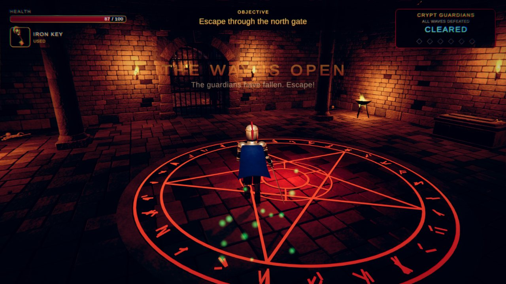
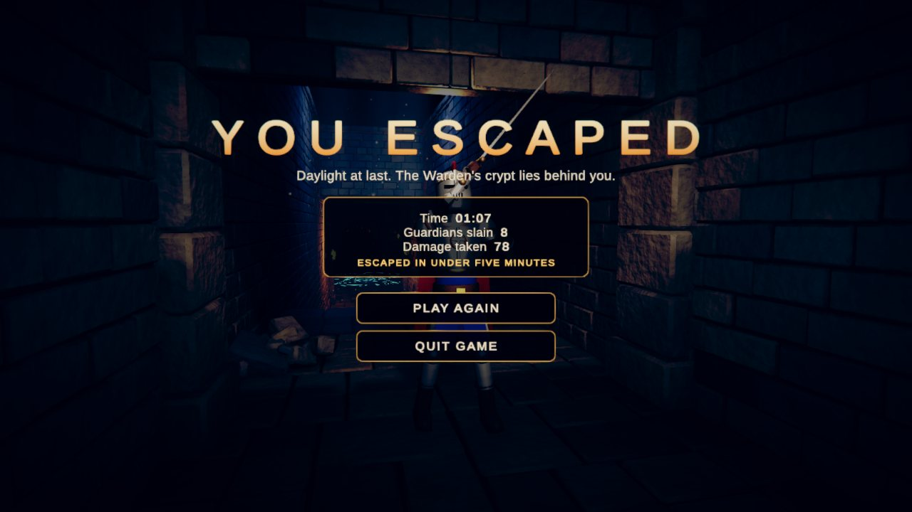
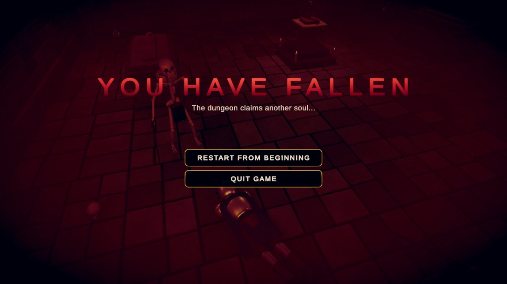

# 地牢逃脱（Dungeon Escape）

Unity 6（6000.4.2f1，URP）第三人称地牢逃脱游戏。角色、环境、道具的模型和动画都在 Blender 5.2 里用脚本原创制作，再导入 Unity；贴图、材质、粒子、音效和界面全部在 Unity 里用代码生成。没有使用任何外部素材。一局正常通关约 1 分钟，慢慢玩也在 5 分钟以内。

## 在哪里

| 内容 | 位置（用户电脑） |
| --- | --- |
| Unity 项目 | `D:/Unity/Projects/Dungeon Escape` |
| 游戏场景（唯一的构建场景） | `Assets/DungeonEscape/Scenes/Dungeon.unity` |
| Windows 构建 | `D:/Unity/Projects/Dungeon Escape/Builds/Windows/DungeonEscape.exe` |
| Blender 文件和建模脚本 | `C:\Users\blender\Documents\DungeonEscape\`（`*.blend`，`scripts\*.py`） |
| 冒烟测试记录和截图 | 构建：`Builds/Windows/SmokeTest/`；编辑器：`C:\Users\blender\Documents\DungeonEscape\SmokeTest\` |

本目录是源码副本：`unity/` 是 `Assets/DungeonEscape` 下的 C# 脚本，`blender/` 是建模和动画脚本，`smoketest/` 是测试记录，`screenshots/` 是构建里截的图。

## 流程

1. **牢房**：玩家在半开的牢门后醒来。镜头、火把和地面引导玩家走出牢房区。
2. **走廊**：一段有断口的走廊，需要跳过去（掉下去也能沿斜坡走回来）。
3. **大厅**：北侧是上锁的大门，红色封印发光；东侧有亮着的火把通道。
4. **钥匙圣坛**：金色光柱照着钥匙，两名骷髅守卫。拿到钥匙后有横幅、音效和 HUD 闪烁，回程路上的火把依次点燃。
5. **开门**：回到大门按 E，封印碎裂、门打开，同时记录检查点。
6. **竞技场**：符文阵亮起、铁闸落下。两波敌人：3 个骷髅，然后是典狱长（Boss）加 2 个骷髅。
7. **出口**：清场后北侧铁闸升起，上楼梯走进日光，进入胜利界面。

失败：生命归零进入失败界面。开门之后可以“从检查点重试”（保留钥匙，大门保持打开），也可以从头开始。胜利、失败、暂停界面都能重新开始。

## 操作

| 动作 | 键鼠 | 手柄 |
| --- | --- | --- |
| 移动 / 镜头 | WASD / 鼠标 | 左摇杆 / 右摇杆 |
| 攻击（三段连击） | 左键 | X / RB |
| 跳跃 | 空格 | A |
| 翻滚（带无敌帧） | Shift / 右键 | B / LB |
| 交互 | E | Y |
| 暂停 | Esc | Start |

## 主要内容

- **玩家**：骑士，100 生命。跑、跳（土狼时间和跳跃缓冲）、三段连击（含重击和命中停顿）、翻滚无敌帧、软锁定、受击、死亡、胜利动画。
- **敌人**：骷髅（60 生命）和典狱长 Boss（280 生命，更慢更重）。NavMesh 寻路追击，同时最多两个敌人进攻；有警觉、攻击前摇、硬直、死亡和掉落治疗球。
- **HUD**：生命条（掉血残影）、钥匙状态（未找到 / 在手 / 已使用）、当前目标、遭遇进度（波次、剩余敌人数）、Boss 血条、交互提示、受伤暗角、敌人头顶血条、区域横幅。
- **路线引导**：路线上的火把、钥匙光柱、门上的红色封印、拿到钥匙后依次点燃的火把、竞技场符文、出口日光。
- **音效**：脚步、挥砍、命中、怒吼、开门、点火、环境低鸣、心跳等，全部由代码合成；走廊带混响。
- **测试工具**：`AutoPilot`（自动通关 / 自动失败测试，见下文）和 `DETicker`（编辑器在后台时手动推进 Play Mode，只用于无人值守测试）。

## 重新生成

菜单 **Dungeon Escape**：`Setup/All`（贴图、材质、模型导入设置）→ `Setup/4 Animator Controllers` → `Build Level`（搭建关卡、烘焙 NavMesh、保存场景并设为构建场景）。Blender 部分：在 Blender 里运行 `blender/` 下的脚本（`dlib.py` 是公共库），输出 FBX 到 `Assets/DungeonEscape/Models/`。

## 自动测试

- 构建：`DungeonEscape.exe -autopilot`（完整通关）或 `-autopilot-defeat`（被守卫打死再重开），结果写到 exe 旁边的 `SmokeTest/`，测完自动退出。
- 编辑器：`DETicker.RunAutopilot(1)` 或 `(2)`，结果写到 `Temp/SmokeTest/`。

## 截图（构建版，自动测试时截取）

| | |
| --- | --- |
|  |  |
|  |  |
|  |  |
|  |  |

截图是离屏渲染的（测试时电脑锁屏），HUD 被临时放进摄像机空间，所以界面颜色比实际游戏略暗。

## 验证结果

全部通过，详见 [`VERIFICATION.md`](VERIFICATION.md)。构建版在 1600×900 下每帧 2.5–3.4 毫秒（关闭垂直同步时约 290–400 FPS）。
