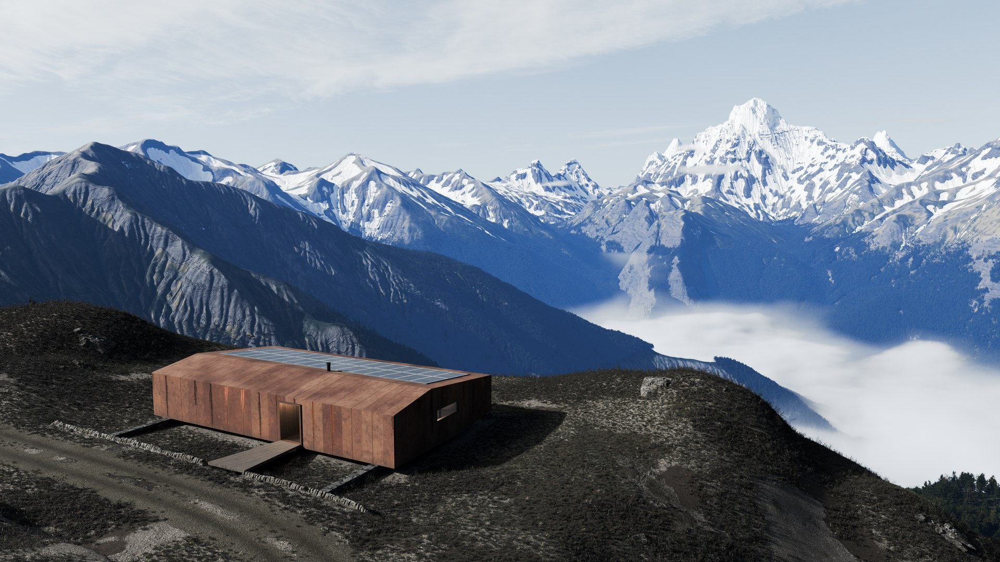

# Mana cafe (玛娜茶金观景台咖啡厅)

A photographic still of the cafe on the Manachajin ridge beside Yading, rendered in Blender 5.2 (Cycles) from the
SketchUp model `玛娜茶金总图咖啡厅.skp`. Everything around the building is rebuilt by the scripts in this folder.



## Files on the PC (`D:\Blender\Projects\mana_cafe\`)

| File | What it is |
| --- | --- |
| `renders\mana_cafe_final_4k.png` | the final image, 3840 × 2160 |
| `mana_cafe_final.blend` | the final scene, 1.6 GB (textures stay in `assets\`, paths are relative) |
| `mana_cafe.blend` | the SketchUp import, untouched |
| `mana_cafe_work.blend` | the working file |
| `assets\fab\` | render-sized copies of the Megascans textures from `D:\fab_downloads`, and `manifest.json` |
| `assets\ph\`, `assets\hdri\` | Poly Haven assets (CC0): the fir trees and the sky `waterkloof_farm` |
| `dem\` | Copernicus GLO-30 tile and the processed terrain rasters and meshes |

## What is in the picture

- **Building**: as modelled. Its materials are rebuilt (`lib/mc_building.py`) and warm lamps are added inside. One
  piece of geometry is added on request: `Door frame (added)`, a steel surround with real depth round the entrance.
  The roof array is shaded as photovoltaic modules (cells, white grid, frames, matt solar glass), and the stone
  base keeps its texture at a darker tone.
- **Site**: no terrace. As in the model, the corten box stands on its recessed stone base and floats 0.42 m above
  natural ground, which runs up to it on every side (`lib/mc_site.py`). One dry-stone wall holds the shoulder of
  the gravel track on the entrance side and ends in the slope at both ends; the boardwalk crosses it.
  The bean bags lie on the balcony (the open loggia along the west side), so the final camera, which looks at the
  east and north faces, does not see them.
- **Terrain**: Copernicus 30 m elevation, registered to the SketchUp geo-location (`proc/terrain_lib.py`), with
  synthesised relief and stream-power erosion (`proc/far_build.py`). The ground within 3 km of the cafe is the real
  ridge; beyond 6 km it is the real Yading massif, moved from 30 km to 10.8 km (`proc/composite.py`) so that the
  peak is the focus of the frame. Snow, rock, scree, turf and forest floor are shaded from terrain masks
  (`lib/mc_mats.py`). The slope across the valley (1–3 km) gets a drainage net: fall-line furrows seeded before the
  erosion (`gully` in `far_build.py`), and in the shader shrub-filled gullies, pale ribs, rock bands and scree runs.
- **Megascans** (from `D:\fab_downloads`, imported by `lib/mc_fab.py`):

  | Asset | Use |
  | --- | --- |
  | Tundra Rocky Ground × 2, Grassy Soil | ground of the first 500 m: box-projected, blended by their height maps; the two 3D ground scans are baked top-down into tiles first (`bake_ground.py`, `proc/fab_seamless.py`) |
  | Gravel Ground | the rutted track |
  | Wild Grass, Tundra Grass, Tufted Grass, Dry Grass, Yellow Flower | turf between the shrubs, in drifts (`lib/mc_ground.py`), at the size of turf at 4400 m: 5–13 cm, tussocks to 27 cm (`SIZES`), about 100 plants per m² |
  | Dwarf Birch, Dwarf Willow, Lingonberry | the dark low shrub cover: knee-high (28–54 cm), creeping mats below it |
  | Tundra Boulder × 2, Tundra Stone, Massive Tundra Rock Formation | rock: hand-placed groups in the foreground, rule-based scatter in the middle distance (`lib/mc_rocks.py`). One ledge of bedrock per group, blocks of 40–70 cm, the rest fist- to head-sized |
  | Mossy Stone Wall | the retaining wall along the track, bent to its line (`lib/mc_stone.py`) |
  | Worn Wooden Planks | boardwalk |
  | Rusty Metal, Wall Rust Leakage × 2 | corten skin and the streaks below its seams |
  | Plain Wool Fabric, Furniture Fabric | bean bags on the balcony (cloth-simulated, `lib/mc_beanbag.py`) |
  | Granite Cliff | crags on the valley flank, 1.4 km away |

  Not used in the final frame: Fresh Snow, Snowy Ground (no snow lies within the first kilometre of this view) and
  Japanese Stone Wall (`build_site.py` takes `WALL='jp_wall'` to swap it in).
- **Light and sky**: a sun lamp (azimuth 116°, 28.6° high: a mid-October morning) and a photographed sky. The sky the
  camera sees is graded apart from the sky that lights the scene. Cloud in the valley and on the peak is volumetric
  (`lib/mc_clouds.py`): one bank lying low in the valley (top about 890 m below the cafe), with broad billows and
  a thin halo that lets its rim fray out.
- **Depth**: air between camera and mountains is a shader (`aerial_group` in `lib/mc_mats.py`). It is computed for
  the *real* distance: everything in the moved massif layer counts as 12.3 km further away than it stands, so the
  peak carries the haze of 23–30 km (lifted blue shadows, snow highlights kept by `P_keep`). The ridges 1–3 km
  away get a small fixed step of haze (`P_mid`), the foreground none; the valley has a thin moist layer over the
  cloud. No depth-of-field blur. `scripts/depth_pass.py` renders the view distance of every pixel and
  `tools/depthcheck.py` measures a render by distance band. Final image (luminance 0–255, 5th / 50th / 95th
  percentile; blue/red of the darkest quarter):

  | Plane | Shadows | Midtone | Highlights | B/R of shadows |
  | --- | --- | --- | --- | --- |
  | foreground, under 120 m | 8 | 46 | 119 | 1.0 |
  | slopes across the valley, 0.7–3.5 km | 40 | 57 | 148 | 2.3 |
  | valley and cloud, 3.5–7 km | 87 | 148 | 227 | 3.0 |
  | massif, over 7 km (real 20–30 km) | 103 | 185 | 249 | 1.8 |
- **Grade**: in the file: AgX, High Contrast look, exposure +0.35, a tone curve, and a compositor step (saturation
  0.82, slightly cool white balance), set by `lib/mc_light.py` (`render_settings`, `grade`). It was tuned against
  the daylight reference photograph with `tools/regrade.py` (sky, sunlit and shaded snow, foreground values).

## Rebuilding

The scripts run from the cloud session through the project tools in `tools/` (see `tools/README.md`) and the shared ones in `../tools/` (run from `mana_cafe/`).

```bash
tools/pyrun.py scripts/proc/fab_prep.py          # texture copies and manifest
tools/pyrun.py scripts/proc/far_build.py far_hi  # then far_lo, near
tools/pyrun.py scripts/proc/mesh_far.py          # then mesh_near.py, trees.py
tools/pyrun.py scripts/proc/paving.py            # flagstone layout (dem/paving.npz); only for a paved terrace, not in the final frame
../tools/rdefer.py scripts/build_fab.py          # Megascans meshes into the open .blend
../tools/rdefer.py scripts/bake_ground.py && tools/pyrun.py scripts/proc/fab_seamless.py
../tools/rdefer.py scripts/build_terrain.py      # then build_site, build_building, look, build_forest,
                                                 # build_scatter, build_rocks, build_clouds, build_bags
tools/rr.py name --scale 100 --samples 400 --res 3840x2160 --png
../tools/rdefer.py scripts/depth_pass.py && tools/depthcheck.py render.png   # planes by distance band
```

`tools/rr.py` leaves the scene at the resolution it was given: pass `--res 3840x2160` after any debug render, because
`lib/mc_rocks.py` reads the picture's aspect when it picks ground positions through the camera.

## Notes

- Nothing in the view is nearer than 30 m to the camera, so the 8K scans are used at 4K (ground bakes at 2K per
  2.4–3.7 m tile). The whole scene renders in about 6 GB of GPU memory.
- The terrain and tree materials carry an emission closure for the air. They are excluded from light sampling
  (`emission_sampling = 'NONE'`); otherwise the light tree of 7 M triangles overflows the GPU.
- Alpha-cut foliage must get the air *before* the transparent mix, or every card the ray crosses adds haze.
- Volume shaders: use object coordinates for a box's envelope; `Generated` is not usable there.
- Blender's display curve (`view_settings.curve_mapping`) acts on scene-linear values before the view transform.
- `Object.dimensions` is stale for library objects that are in no view layer (the imported scans): measure the
  mesh vertices instead (`mc_ground.mesh_size`). Plants are sized through scaled copies of the objects (`sized`),
  so the scatter's Collection Info must not reset its children.
- A cloud top only shows sunlit billows if the cloud is firm there (free path of some 25 m against billows of a
  kilometre). A wide soft threshold alone gives a flat sheet of fog; a height-field top gives sand dunes.
