# 单词守城（Word Defense）

英语单词塔防：敌人头顶英文单词，沿 S 形道路冲向城堡；屏幕下方是写着中文释义的炮弹。先点对的释义，再点对应的敌人，把它击倒。

Unity 6（6000.4.2f1，URP）制作。所有模型都在 Blender 5.2 里用脚本原创建模后导入；界面、特效、音效和贴图在 Unity 里用代码生成，没有外部素材。单词和释义在运行时直接从 `vocabulary.db` 读取。一局（4 波 + Boss）约 3–5 分钟。

## 在哪里

| 内容 | 位置（用户电脑） |
| --- | --- |
| Unity 项目 | `D:/Unity/Projects/Word Defence` |
| 游戏场景（唯一的构建场景） | `Assets/WordDefense/Scenes/WordDefense.unity` |
| Windows 构建 | `D:/Unity/Projects/Word Defence/Builds/Windows/WordDefense.exe` |
| Blender 文件和建模脚本 | `C:\Users\blender\Documents\WordDefense\`（`WD_*.blend`，`scripts\*.py`） |
| 学习记录（记忆深刻等） | `%USERPROFILE%\AppData\LocalLow\WordDefense\Word Defense\memory.json` |
| 冒烟测试记录和截图 | 构建：`Builds/Windows/SmokeTest/`；编辑器：`Temp/SmokeTest/` |

本目录是源码副本：`unity/WordDefense/` 是 `Assets/WordDefense` 下的脚本和着色器，`blender/` 是建模脚本，`tools/` 是开发时用的同步和测试脚本，`smoketest/` 是测试记录，`screenshots/` 是构建版截图和模型展示图。

## 怎么玩

1. 敌人从右上角的传送门出来，沿道路走向左边的城堡，头顶是英文单词。
2. 下方始终有 4 个中文释义炮弹（键 1–4）。先点一个释义，再点头顶单词对应的敌人；点单词标签或敌人本身都可以，右键取消。
3. 答对：炮弹划出弧线命中，敌人被击倒，弹出“单词 + 释义”和得分。答错：见下文“答错之后”。
4. 敌人走到城堡会撞城：小墨灵 −8、墨卫 −10、墨巨像 −18、Boss −100。城堡 100 耐久，归零失败。
5. 第 4 波之后 Boss 来袭；击破 Boss 获胜。胜利和失败界面都可以“再来一局”或“返回标题”。

| 操作 | 按键 |
| --- | --- |
| 选择释义炮弹 | 点卡片，或 1–4 |
| 发射 | 点敌人或它的单词标签 |
| 取消选择 | 右键 / Esc |
| 寒霜齐射 | 空格，或点左下角 |
| 暂停 | Esc / P，或右上角按钮 |

## 设计说明

### 词库怎么用

- **运行时直接读数据库。** 游戏自带一个只读 SQLite 解析器（纯 C#，按 SQLite 文件格式遍历 B 树，不依赖原生库），启动时在后台线程读取，约 1 秒。读取顺序：`-vocab <路径>` 参数 → `文档\vocabulary.db`（你的词库更新后游戏直接用到）→ 随游戏附带的副本（构建前会自动从文档同步）。
- **结构。** `Words` 表 95,297 行：`vocab`、`definition`、`example`、`example_chinese`、`stability`、`difficulty`、`due_date`、`last_review`、`book_identities`；`Word_Book` 表 5 本词书（Pre_Generate、User_Import、CET_4+6_edited、TOEFL、GRE_8000_Words）。
- **中等难度。** `difficulty` 字段实际上是“单词长度 ÷ 10”（封顶 1.0，0.0 表示未评级）。把 0–1 三等分，中等 = 0.4–0.6，即 4–6 个字母。另外只取 CET-4/6 和 TOEFL 词书里的词：GRE 词书的词即使很短也偏难，留给以后的高难度。
- **释义清洗。** Pre_Generate 词书里很多释义其实属于派生词：`argue` →“不容置疑地”（来自 arguably）、`urban` →“城市化”（urbanize）、`self` →“无私”（selfless）、`solve` →“未解决的”（unsolved）。游戏按以下规则逐个义项过滤：
  1. 去掉人名、地名、缩写、学科标注行；
  2. 括注里写着“别的词的复数/过去式……”时整条丢弃；
  3. 按词形检查：“…地”只给 -ly 词，“…者/贩”只给 -er/-or 等，“…论”只给 -ism，“…化”只给 -ize/-ify，“最…”只给 -est，“不/未/无/非…”只给 un-/in-/dis- 等否定词，名词义项不能以“的”结尾；
  4. 如果更长的派生词（同词根、不是单纯变形）也列着同一个义项，就算借来的，丢弃（self/selfless、space/spacious）；
  5. 最后要求这个义项出现在该词自带例句的中文翻译里。这一步同时选出语境里的那个意思，例如 `kidnap` 取“绑架”而不是“拐骗罪”。
- **结果。** 3,613 行中等难度的词 → 2,803 个可用 → 1,113 个经例句确认的词进入出题池。炮弹上只显示中文释义，不显示词性（词库里的词性标注常常不对）。

### 记忆深刻怎么判定

每个词有一份小型 FSRS 风格的记忆记录（`memory.json`，跨局保存）：

- 从敌人出现（且它的释义已在炮弹里）到答对的时间就是回忆速度：3 秒内 = 轻松，6.5 秒内 = 良好，更慢 = 吃力；答错或让它撞城 = 遗忘。
- 稳定度（天）随每次答对增长（轻松 ×3.2、良好 ×2.4、吃力 ×1.6，新词分别从 2.4 / 1.2 / 0.6 起步），遗忘时降到原来的四分之一。可提取度按 FSRS 遗忘曲线随真实时间衰减：R = (1 + t / 9S)⁻¹。
- **稳定度 ≥ 3 天且 R ≥ 0.85 即“记忆深刻”**：实际效果是连续两次快速答对（或三次普通答对）。答错一次就会失去；大约两周不练，可提取度降到 0.85 以下，也会淡掉。
- 如果 `vocabulary.db` 里的 `stability` / `last_review` 有你在背词软件里的复习数据，同样计入（现在都是 0）。
- 记忆深刻的词的炮弹是金色的，点一下就自己发射并追踪目标，不用再点敌人；目标还没出现时会“待命”，敌人一出现就自动发射。每局会专门放回 3 个记忆深刻的词（Boss 关键词和补位的词也可能恰好是记忆深刻的），复习的同时享受奖励。

### 答错之后

答错不只是扣分，而是一次纠错机会：

- 炮弹被敌人的墨盾弹开（红色冲击环、震动、音效），连击归零，寒霜充能清空；
- 炮台装填 0.9 秒，期间不能发射，防止乱猜；
- 这颗炮弹留在原位（释义本身没错，只是用错了对象）；
- 被打错的敌人头顶亮出它的真正释义 2.6 秒，底部提示“答错了：gaol 的意思是「监禁」，这个词稍后会再出现”；
- 这个词记为遗忘，并安排在 3 个敌人之后再次出现（漏掉撞城的词在 2 个之后再出现），下一局也会优先复习。

### Boss：长句

- 每局先选好 Boss 句子，再把句中的关键词放进本局词组，所以前面 4 波教的正是 Boss 要考的词。
- 句子来自词库例句。候选句要 7–20 个词、没有乱码和数字、有中文翻译，并至少有 3 个关键词（中等难度、释义能在这句的翻译里找到，并参考前一个词判断词性，如 “the mirror” 取名词义）。按“关键词释义被两句例句同时证实、句长适中、少用生僻长词”打分，从前 12 句里随机选，不连续重复。
- 屏幕上方显示整句，关键词按顺序编号；当前关键词高亮，打掉的显示绿色释义。托盘里始终同时放着**当前和下一个关键词**的释义，每一发都要选对顺序。顺序错了或释义错了，Boss 会挡开并向前冲一段。
- 每击中一个关键词，Boss 胸前掉一块甲片，并被击退一步。全部击中后 Boss 碎成纸片，整句中文译文揭晓。Boss 战期间还会有小兵护送。

### 其他规则

- **炮弹托盘**：始终 4 个；只要场上有敌人，至少一个能对应场上的某个敌人（每帧检查，不满足就替换最旧的干扰项）。补充时优先给还没有炮弹的敌人，其次预先放入下一个可能出现的词，干扰项从已经见过的词里选，并且不能和场上任何释义相近。
- **越来越快**：敌人速度 = 基础速度 × (1 + 每波 10% + 每秒 0.35%)，上限 2.2 倍；HUD 显示当前倍率，波次横幅提示加速。实测第 1 波 ×1.00，第 4 波 ×1.55，Boss 时 ×1.87。
- **寒霜齐射**：连续答对 3 次充满左下角的三段环，按空格让全体敌人（包括 Boss）减速到 35%，持续 6 秒。
- **HUD**：城堡耐久（带掉血残影）、波次和敌速、得分和连击、寒霜充能与状态、本局记忆深刻和答对进度、Boss 句子面板。

## 美术

- **模型（Blender 脚本，`blender/`）**：浮空岛（起伏草地、分层岩壁、倒锥形岩底）、S 形道路和路边石、树林、房屋、风车（叶片可转）、池塘、路灯、云；城堡（四座塔楼、主堡、城门、旗帜都是独立部件，失败时依次倒塌）和能转向、俯仰、后坐的大炮；三种墨灵敌人和 Boss（四肢独立、关节处设轴心，用于程序化行走；Boss 胸前四块甲片按阅读顺序排列，可逐块打落）；传送门（旋转的门核、漂浮水晶）；炮弹。导出前统一了坐标系，配色在 Blender 和 Unity 中按材质名一一对应。
- **画面**：URP，软阴影、SSAO、Bloom、色调映射和分离色调；渐变天空和雾让浮岛有纵深。
- **界面**：深色半透明面板，配英文 Inter、中文思源黑体（Noto Sans SC，两者都是 SIL OFL 开源字体，随游戏打包）。中文用同一个可变字体的 Regular / Bold / Black 三个字重。圆角、阴影和图标（城堡、雪花、星星、皇冠等）都由代码绘制。
- **音效**：开炮、命中、答错、撞城、寒霜、Boss 怒吼、胜利和失败等音效，以及一段 16 秒的背景音乐，全部在运行时合成。

## 重新生成

1. Blender：依次运行 `blender/wd_world.py`、`wd_castle.py`、`wd_units.py`（`wdlib.py` 是公共库），FBX 输出到 `Assets/WordDefense/Models/`，道路数据输出到 `Assets/WordDefense/Data/path.json`。
2. Unity：菜单 **Word Defense → Setup → All**（字体、贴图、材质、模型导入设置、项目设置、场景）。
3. 构建：**Word Defense → Build Windows Player**。
4. 模型展示图（可选）：在 Blender 里运行 `blender/wd_showcase.py`，渲染到 `C:\Users\blender\Documents\WordDefense\showcase_*.png`，不改动当前打开的文件。

## 自动测试

内置的 `AutoPilot` 走玩家相同的输入路径：通过 EventSystem 点卡片、单词标签和按钮，对场景做射线点击敌人，并模拟按键。

- 构建：`WordDefense.exe -autopilot`（完整通关，再开一局测记忆深刻追踪）或 `-autopilot-defeat`（失败、重开、返回标题）。结果写到 exe 旁的 `SmokeTest/`，测完自动退出。测试使用单独的学习记录 `memory_autotest.json`，不影响你的进度。
- 编辑器：`WDTicker.RunAutopilot(1)` 或 `(2)`，结果写到 `Temp/SmokeTest/`。

## 截图

下面的游戏截图来自构建版自动测试（1600×900，`Builds/Windows/SmokeTest/`），模型图是 Blender 里的棚拍渲染（`blender/wd_showcase.py`）。

| | |
| --- | --- |
| 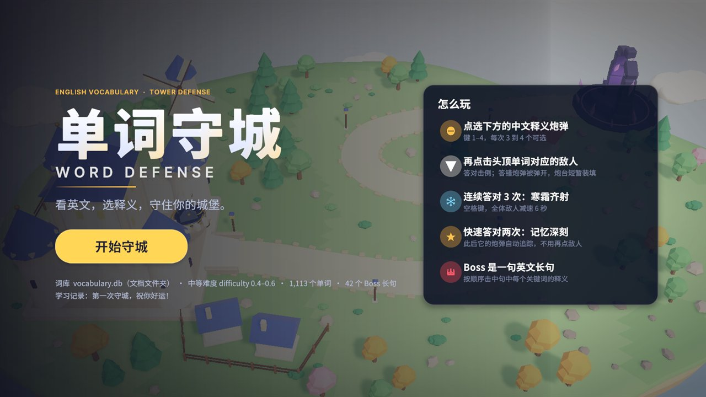 | 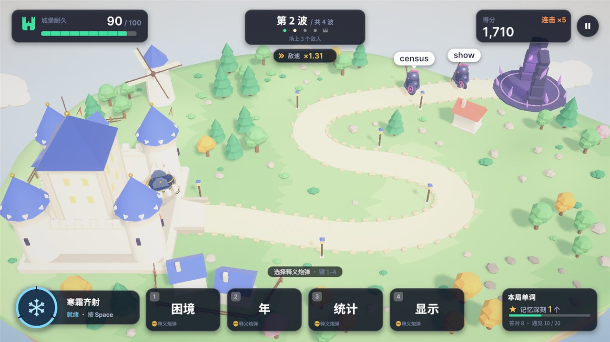 |
| 标题界面：词库来源、出题范围和玩法说明 | 第 2 波：敌人头顶英文单词，下方 4 个中文释义炮弹 |
| 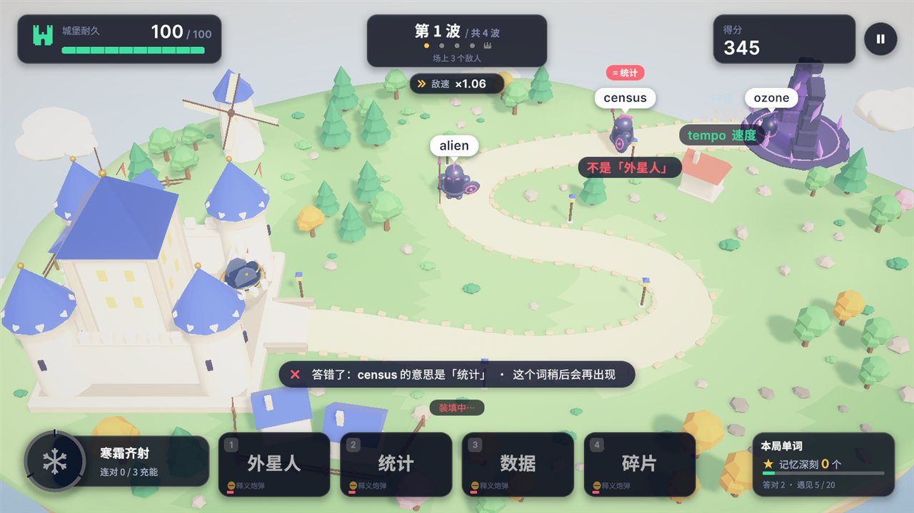 | 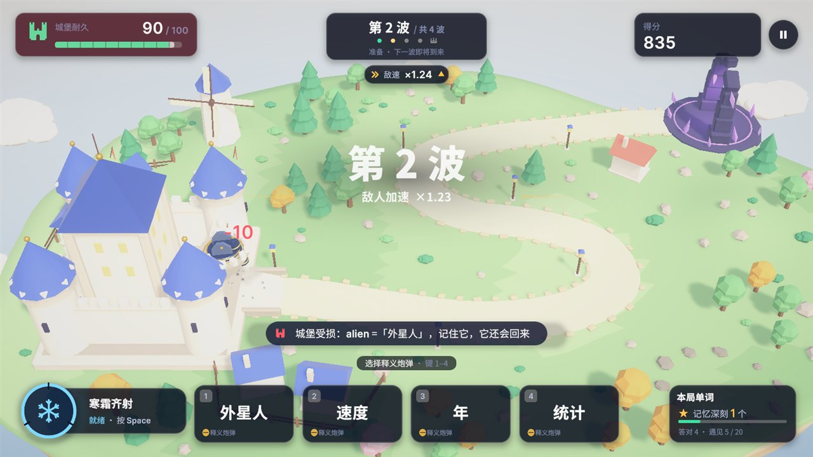 |
| 答错：炮弹被弹开，敌人亮出真正的释义，炮台装填 | 敌人撞城：扣耐久，提示这个词的意思，稍后再出现 |
| 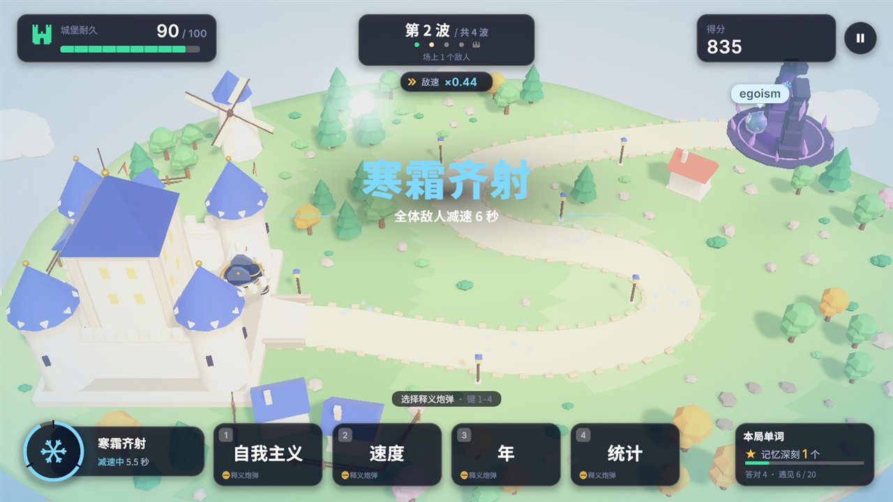 | 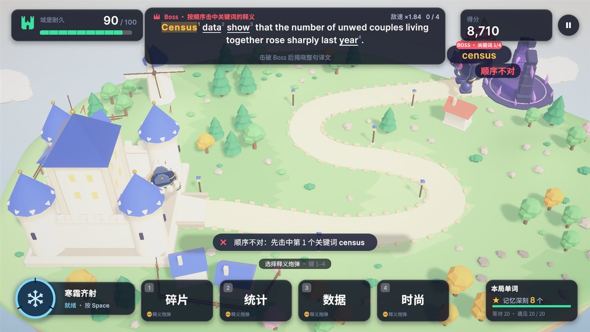 |
| 连对 3 次后的寒霜齐射：全体敌人减速 | Boss 长句：按顺序击中关键词，顺序错会被挡开 |
| 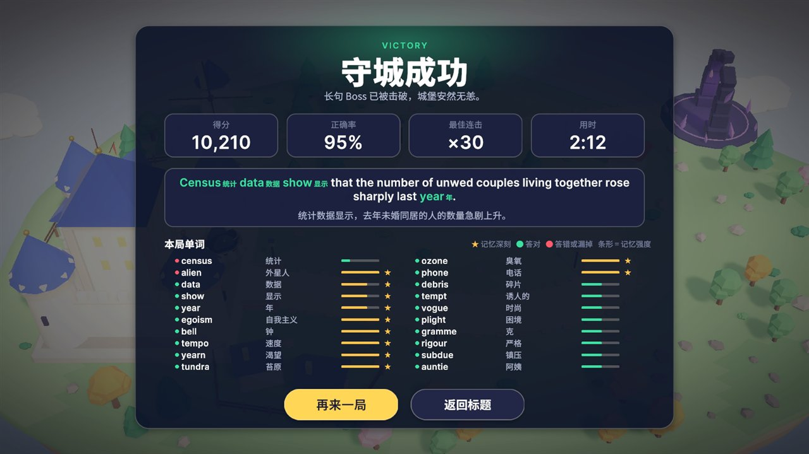 | 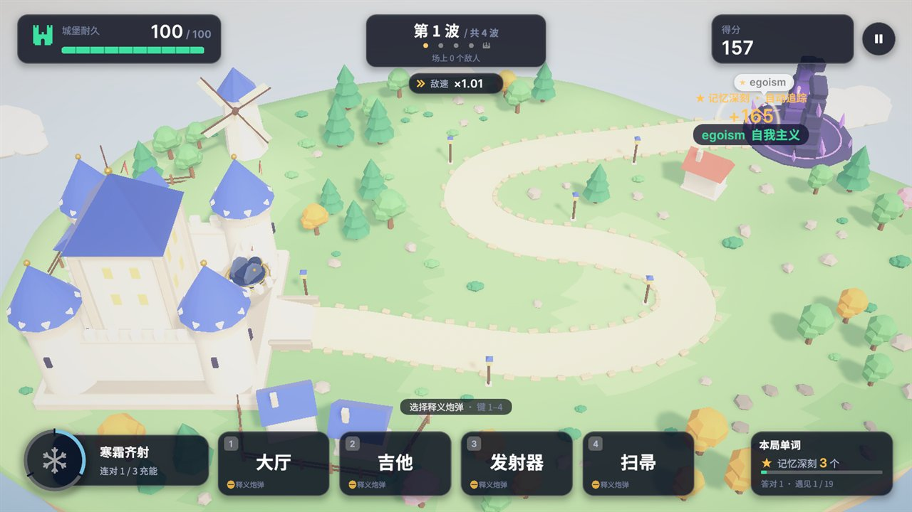 |
| 胜利：整句译文揭晓，本局单词和记忆强度 | 第二局：记忆深刻的金色炮弹点一下就自动追踪 |
| 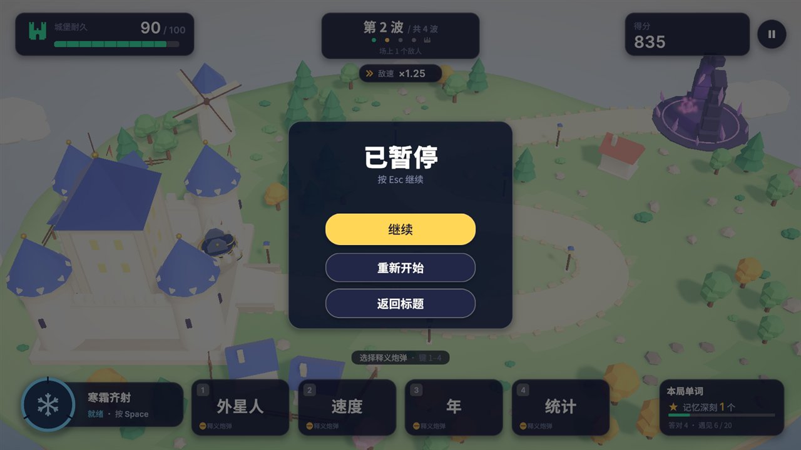 | 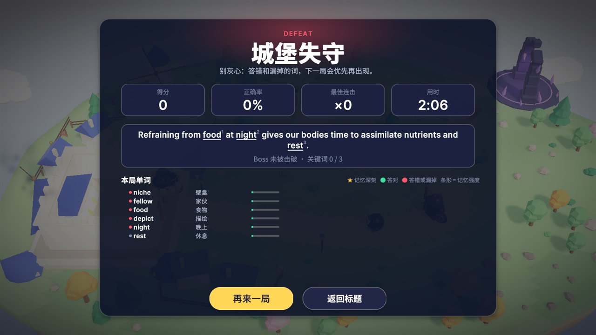 |
| 暂停菜单 | 失败：可以再来一局或返回标题 |

| | |
| --- | --- |
|  | 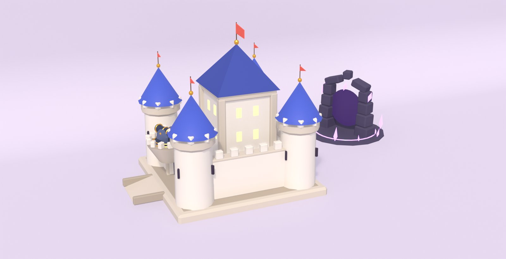 |
| 墨灵 Boss、墨巨像、小墨灵、墨卫和释义炮弹 | 城堡（炮台在左侧棱堡上）和敌人出发的传送门 |

## 验证结果

见 [`VERIFICATION.md`](VERIFICATION.md)。
